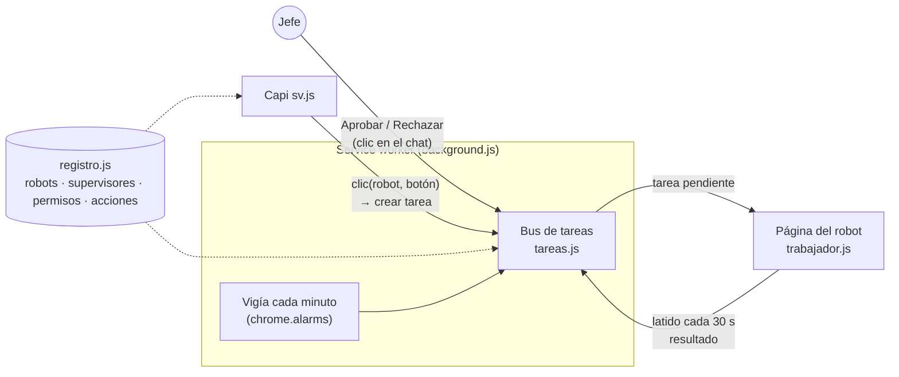

# Fase 2: Arquitectura (v1.62.0)

Primera pieza de la columna vertebral v2.0 que propuso la auditoría: **registro central + bus de tareas + permisos en código + Capi supervisando por el bus**.

La migración es **gradual**: los robots siguen siendo los mismos y conservan todos sus botones. En esta versión 5 acciones ya pasan por el bus; las demás se irán migrando una por una.

## Las piezas nuevas

| Archivo | Qué es |
|---|---|
| `registro.js` | **Registro central de robots.** Nombre, rol, supervisor (GEO, CRM, GROW, OPS; Capi es el principal), página, permisos y acciones del bus. Antes estos datos estaban copiados en 6 lugares que ya no coincidían (Capi decía "16 robots" y eran 25). Ahora lo usan Capi, el Centro de Mando, las cabeceras de los robots y la pantalla de "apagado" |
| `tareas.js` | **Bus de tareas** que corre en el service worker. Guarda las tareas en `chrome.storage` (`tareas`) |
| `trabajador.js` | Va en cada página de robot. El robot reclama sus tareas, manda latidos y reporta el resultado. Capi también lo usa para crear y consultar tareas |

### Cómo funciona una tarea

- **Estados:** `aprobacion` → `pendiente` → `corriendo` → `hecha`. Las otras salidas son `fallida`, `cancelada` y `rechazada`.
- **Sobrevive al cierre del panel:** si la página del robot no está abierta, la tarea espera en fila y el robot la toma cuando su página vuelve a abrir.
- **No se duplica:** si ya hay una tarea viva del mismo robot y la misma acción, se regresa esa.
- **Solo la corre un robot**, aunque haya dos pestañas de la misma página abiertas.
- **Permisos en código:**
  - Una acción marcada `aprobacion: true` en el registro queda **esperando tu aprobación**. Te aparece en el chat de Capi con los botones **Aprobar** y **Rechazar**.
  - Capi **no tiene** herramienta para aprobar.
  - Ninguna acción de SMS está en el bus.
- **Vigía:** cada minuto, aunque el panel esté cerrado, revisa:
  - si un robot dejó de responder por 2 minutos, suelta su tarea (se reintenta una vez y luego queda `fallida`);
  - si una aprobación lleva 24 h sin respuesta, se vence.
- **Solo páginas de la extensión** pueden usar el bus: los content scripts de sitios web no pueden.

### Acciones que ya pasan por el bus

| Robot | Acción | ¿Aprobación? |
|---|---|---|
| Chequi | `revisar` | No |
| Chequi 3 | `revisar` | No |
| Zeta | `revisar` | No |
| Resi | `revisar` (solo lee; deja notas si están prendidas) | No |
| Limpi | `limpiar` (mueve leads a No Active Plans) | **Sí** (antes Capi la corría con un clic) |

Cuando Capi usa `clic` con uno de esos botones, ya **no toca la página**: crea la tarea y te regresa el resultado.

Capi tiene dos herramientas nuevas: `ver_tareas` y `cancelar_tarea`. Además, `ver_estado` ahora incluye las tareas.

### Cambio en los permisos de la extensión

`manifest.json` ahora pide **`alarms`**, que usa el vigía. Como la extensión está cargada desde una carpeta, Chrome no muestra aviso.

## Pruebas

- **Pruebas automáticas:** `node --test tests/*.test.js` corre **38 pruebas**, todas pasan. 11 son nuevas, del bus y del registro (`tests/tareas.test.js`).
- **Prueba de punta a punta** en un Chromium aislado (sin cuentas ni internet):
  1. Tarea para Chequi con su página cerrada → `pendiente`. Al abrir la página la tomó sola → `hecha`.
  2. La misma tarea pedida dos veces → misma tarea.
  3. Limpi pedido por Capi → `aprobacion` y tarjeta en el chat. Al pulsar Rechazar → `rechazada`.
  4. `clic` de Capi sobre `zb run` → pasó por el bus y regresó el resultado.
  5. `leer_pestana` sobre un banco → bloqueado.
  6. Sin errores de JavaScript en las páginas.
- **Con tus cuentas reales no se probó.**

### Verificación manual sugerida

1. Recarga la extensión y confirma que diga **1.62.0**.
2. Pídele a Capi "revisa zBuyer". Debe responder con el resultado de la tarea.
3. Pídele "corre la limpieza del CRM". Debe salir la tarjeta **Aprobar / Rechazar**: dale **Rechazar** si no quieres que corra.

## Siguiente en la Fase 2 (pendiente)

- Migrar al bus más acciones con contrato de entrada y salida:
  - Propi `buscar` (zona, páginas);
  - Veri `ciclo`;
  - Owny `leer`;
  - Acti `traer`;
  - Heri `buscar`;
  - Lofti `subir` (con aprobación, reemplazando la ventana actual).
- Pasar el **motor de misiones** de Capi del DOM al bus (hoy sigue con clics).
- Tablero de tareas en el Centro de Mando (Fase 5).
- Candado entre varios paneles laterales; reducir `<all_urls>`.
