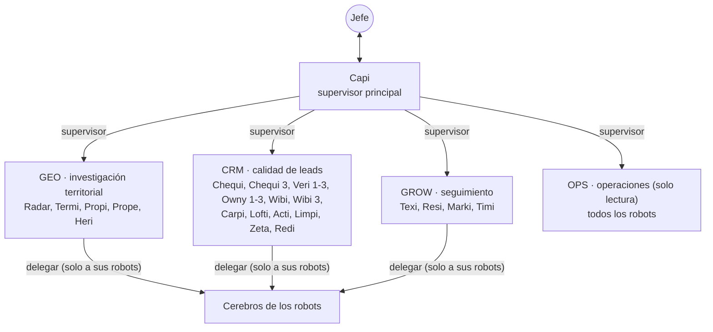

# Fase 3: Supervisores (v1.63.0)

Capi sigue siendo el **supervisor principal**: el único que habla contigo. Debajo de él hay cuatro supervisores, cada uno con su propio cerebro de Claude, **solo sus robots** (según `registro.js`) y herramientas limitadas.



## Qué puede hacer cada uno

| | Ver estado y tareas | Leer pestañas de trabajo | Clic / bus | Cambiar ajustes | Delegar a robots | Ver uso de Claude |
|---|---|---|---|---|---|---|
| **GEO** | ✓ | ✓ | ✓ sus robots | ✓ sus robots | ✓ sus robots | — |
| **CRM** | ✓ | ✓ | ✓ sus robots | ✓ sus robots | ✓ sus robots | — |
| **GROW** | ✓ | — | ✓ sus robots | — | ✓ sus robots | — |
| **OPS** | ✓ | ✓ | — | — | — | ✓ |

**Ningún supervisor puede:**
- subir a Lofty;
- prender o apagar robots;
- aprobar tareas;
- encargar trabajo a otro supervisor;
- mandar SMS.

Si algo de eso hace falta, se lo dicen a Capi y Capi te pregunta a ti.

Las reglas de Fases 1 y 2 siguen aplicando dentro de cada supervisor:
- los ajustes sensibles siguen bloqueados;
- solo se leen sitios de trabajo;
- las acciones con aprobación esperan tu clic.

## Cómo se usa

No cambia nada para ti: le hablas a Capi como siempre. Capi decide:
- **`supervisor`** cuando es un área completa. Por ejemplo, "¿cómo va la calidad de los leads?" va a CRM, y "¿por qué se atoró todo?" va a OPS.
- **`delegar`** cuando es un solo robot.
- Los **avisos automáticos con errores técnicos** se los pasa a OPS.

En el chat ves lo que hace cada supervisor con 🧭.

## Presupuesto de Claude (nuevo)

`presupuesto.js` pone un **tope diario de tokens** a cada quien que llama a Claude. El día se cuenta en hora de California.

| Quién | Entrada / día | Salida / día |
|---|---|---|
| Capi | 2,000,000 | 150,000 |
| GEO, CRM, GROW | 400,000 c/u | 40,000 c/u |
| OPS | 300,000 | 30,000 |
| Cerebros de los robots (`delegar`) | 600,000 | 60,000 |
| Resi (clasificador de SMS) | 300,000 | 30,000 |

- Antes no había ningún tope: solo se mostraban los tokens de la sesión.
- Al llegar al tope, ese supervisor ya no llama a Claude hasta el día siguiente. Resi sigue clasificando con sus reglas.
- **Falla cerrada:** si no se puede leer el presupuesto, no se llama a Claude.
- Pregúntale a Capi "¿cuánto llevamos de Claude hoy?" (usa `ver_uso`).
- Para cambiar un tope, en la consola de la pestaña de Capi:
  ```js
  chrome.storage.local.set({ llmTopes: { CRM: { entrada: 800000, salida: 80000 } } })
  ```
- Se cuentan **tokens, no dólares**, porque el precio depende del modelo que elijas y cambia.

## Pruebas

- **Pruebas automáticas:** `node --test tests/*.test.js` corre **43 pruebas**, todas pasan. 5 son nuevas, de presupuesto.
- **Prueba de punta a punta** en un Chromium aislado, con **Claude simulado** (sin llamadas reales ni gasto):
  - GROW intentó dar clic a Limpi → "no es de tu área". Intentó cambiar un ajuste → "esa herramienta no es tuya".
  - OPS intentó dar clic → bloqueado. `ver_uso` sí funcionó.
  - El clic de CRM sobre Zeta pasó por el bus de tareas.
  - GEO con tope chico: la 1ª vez respondió y la 2ª se detuvo por presupuesto.
  - Un robot no puede llamar a un supervisor.
  - Sin errores de JavaScript.
- **No se probó con tu API key ni con tus cuentas reales.**

### Verificación manual sugerida

1. Recarga la extensión: debe decir **1.63.0**.
2. Pregúntale a Capi "OPS, ¿cómo está todo?". Deben salir burbujas 🧭 OPS y un resumen.
3. Pregúntale "¿cuánto llevamos de Claude hoy?".

## Pendiente

- **Migrar al bus las acciones grandes:** Propi buscar, el ciclo de Veri, leer de Owny, traer de Acti, buscar de Heri y subir de Lofti. Después, el motor de misiones. Sin eso, los supervisores todavía operan a esos robots con clics.
- **Precios en dólares:** se puede agregar después, con una tabla de precios mantenida por ti.
- **Tablero de supervisores, tareas y uso** en el Centro de Mando (Fase 5).
