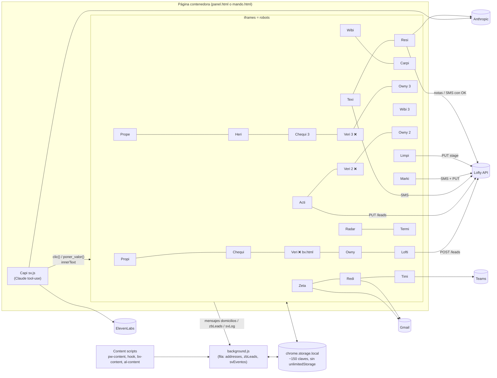
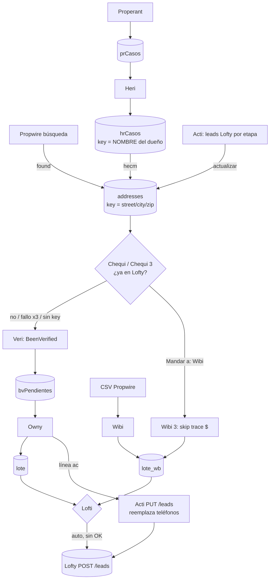
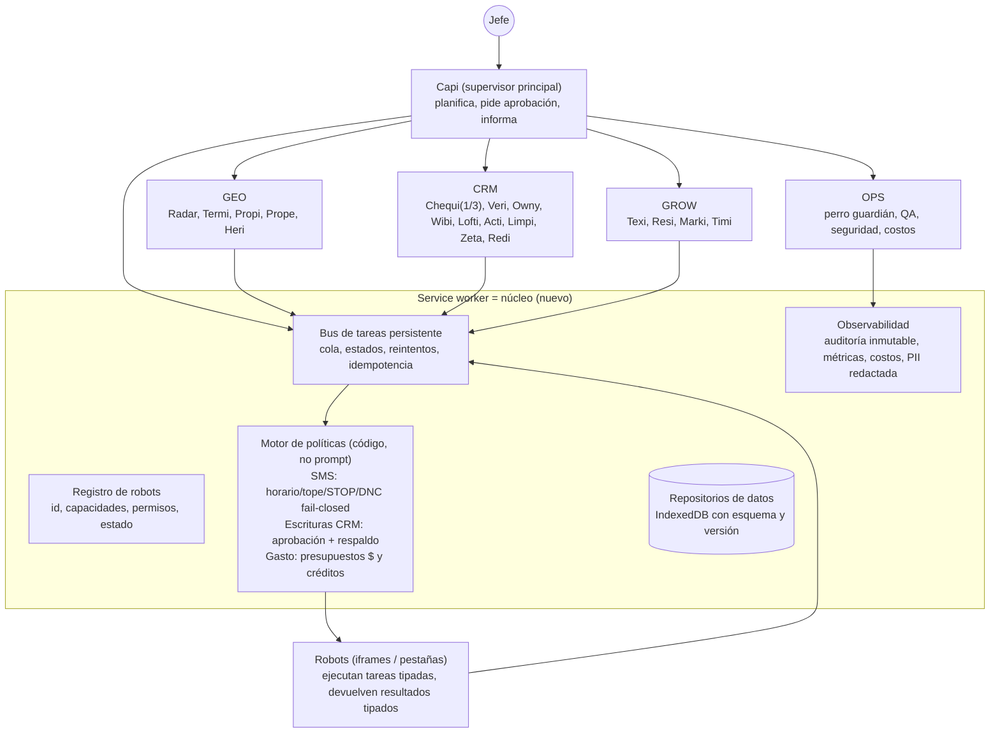

# MISIÓN 01 — AUDITORÍA TÉCNICA INTEGRAL
## Agente Geo Farming · Centro de Mando

**Fecha:** 2026-11-20
**Repositorio:** `dead01187-cyber/CENTRO-DE-MANDO`, rama `claude/peaceful-fermi-mfgt13`, commit único `79493f0`
**Modo:** solo lectura. No se modificó, creó ni borró ningún archivo del proyecto. No se hicieron llamadas a Lofty, Propwire, BeenVerified, Gmail, Teams, Anthropic ni ElevenLabs. No se envió ningún SMS.

> **Aviso de versión.** La misión pide auditar la **v1.47.0**, pero `manifest.json` del repositorio dice **`"version": "1.60.0"`**. Esta auditoría corresponde al código real del repositorio (v1.60.0). Si existe una copia local v1.47.0 distinta, sus hallazgos pueden variar.

### Cómo leer este informe

| Etiqueta | Significado |
|---|---|
| **Error confirmado** | Defecto demostrado leyendo el código, ejecutando una función pura con datos falsos, o ambas cosas |
| **Riesgo potencial** | Ruta de fallo plausible según el código, sin reproducir en producción |
| **Mejora** | Deuda técnica o diseño mejorable |
| **No verificable** | Requiere red, cuentas reales o archivos que no están en el repo |

**Pruebas que sí se ejecutaron:**
- `node --check` en los 49 archivos JS: los 49 pasan sin errores de sintaxis.
- Pruebas en memoria, con datos inventados, de funciones puras de `comun.js`, `lofty-core.js` y la función `firma` de `wb.js`.

**Pruebas que no se ejecutaron:** ninguna prueba de integración ni de interfaz, porque todas requieren cuentas reales.

---

## 1. Resumen ejecutivo

El "Agente Geo Farming" es una extensión de Chrome **Manifest V3** de unas **15,900 líneas** de JavaScript, HTML y CSS. Sin frameworks ni build, y **sin pruebas automáticas**. Contiene **25 "robots"** y un supervisor (**Capi**).

**Cómo funciona por dentro:**
- Cada robot es una **página HTML dentro de un iframe** del panel lateral (`panel.html`) o del Centro de Mando (`mando.html`). No son workers ni agentes independientes.
- Los robots se coordinan por `chrome.storage.local`.
- **Capi** es un bucle de *tool use* de Claude que opera a los robots **haciendo clic en sus botones y leyendo el texto de sus iframes**.

**Lo que está bien:**
- Muchas decisiones de seguridad están bien pensadas y deben conservarse:
  - Redi **solo crea borradores** de correo.
  - Capi no puede mandar SMS.
  - Texi pide OK antes de enviar.
  - El background escribe en fila las claves compartidas.
  - Todos los `innerHTML` con datos externos pasan por `esc()`.
  - La CSP por defecto de MV3 bloquea scripts en línea.
- El dominio del negocio está muy bien codificado: HECM/Celink, reclamos a zBuyer y ritmo humano.

**Lo que no está bien.** Hay problemas que requieren atención inmediata:

1. **🔴 Falta `bv.html`.** Veri, Veri 2 y Veri 3 no pueden arrancar con el código del repositorio. Acti queda atorado porque depende de Veri 2. *(Error confirmado. Hay que verificar si existe en la instalación local.)*
2. **🔴 Cumplimiento de SMS (TCPA/CTIA).** El problema más grave del sistema:
   - Marki manda **SMS masivos sin confirmación por número**, sin revisar bajas ni DNC.
   - Texi **manda aunque falle la revisión de opt-out** (*fail-open*).
   - La baja **STOP no queda fija**.
   - **No hay horario 8am–9pm, tope diario ni verificación de consentimiento** en ningún camino de envío.
3. **🔴 Datos que llegan a Lofty sin control:**
   - Lofti sube automáticamente **por defecto, sin confirmación humana**.
   - Puede **reintentar sin fin** y duplicar leads.
   - **"Vali" (validación de teléfonos) no existe en el código**, aunque la pantalla dice que está activa.
   - Wibi **no quita los DNC** aunque el filtro esté marcado.
4. **🟠 Dinero.** Wibi 3 puede **aprobar solo un cobro de Propwire de distinto monto**: su "firma" de aprobación ignora el monto.
5. **🟠 Capi no es un orquestador robusto:**
   - Depende de la interfaz: clics y texto.
   - El permiso para subir a Lofty lo decide el modelo, no el código.
   - Puede leer **cualquier pestaña https** y mandar su texto a Anthropic.
   - No tiene cola de tareas persistente, ni control de costo en dólares, ni verificación de resultados.

**Viabilidad de v2.0.** La arquitectura **sí puede evolucionar** a cuatro supervisores (GEO, CRM, GROW, OPS) bajo Capi. Es posible **sin reescribir todo**: se conservan la lógica de dominio y los scripts de scraping, y se agregan:
- un registro central de robots;
- un bus de tareas en el service worker;
- una capa de "política" en código (permisos, cumplimiento) que el LLM no pueda saltarse.

**Recomendación:** antes de cualquier evolución, una **Fase 1 de estabilización centrada en SMS y en escrituras a Lofty**.

---

## 2. Inventario completo del proyecto

92 archivos en total: 49 JS, 28 HTML, 3 CSS, 1 JSON, 1 SVG, 9 imágenes, README, .gitignore y la app de macOS.

### 2.1 Núcleo, infraestructura y supervisión

| Archivo | Función | Dependencias | Importancia | Riesgo |
|---|---|---|---|---|
| `manifest.json` | MV3: permisos `storage, tabs, scripting, sidePanel, downloads, activeTab, tts`; `host_permissions: <all_urls>`; content scripts para Propwire, BeenVerified y Lofty | — | Crítica | **Alto** (`<all_urls>`; falta `alarms`) |
| `background.js` (176) | Service worker. Único escritor en fila de `addresses`, `zbLeads`, `svEventos`; poda a 60 días; sesión de Propi; alarma de Resi (muerta) | comun.js | Crítica | Medio |
| `comun.js` (293) | Lógica compartida: `keyOf`, `sirve`, `pasaFiltro`, `enLoftyPorDomicilio`, `loftyApi` (429/503 + 3 cupos), `turnoPropwire`, `conteos`, ventanas de trabajo, `domicilios()`/`zbPoner()` con respaldo de escritura directa | — | Crítica | **Alto** (respaldo sin fila; fail-open) |
| `log.js` (29) | `svLog` → background → `svEventos` (tope 150); voz si hay captcha | chrome.tts | Alta | Medio (PII en bitácora) |
| `robot.js` (180) | Avatares, chip de estado, interruptor (solo al cargar), tema | — | Media | Bajo |
| `apagar.js` (43) | Interruptores: cambia el `src` del iframe a `apagado.html` | — | Media | Bajo |
| `apagado.js/.html` | Pantalla "robot apagado" | robot.js | Baja | Bajo |
| `linea.js` (7) | `LINEA` y `K()`: clones por línea (`ac`, `hr`) | — | Alta | Bajo |
| `panel.js/.html` | Panel lateral con 20 iframes; candado BroadcastChannel frente al Mando | comun, robot, apagar | Crítica | Medio (varias instancias) |
| `mando.js/.html` (583/249) | Centro de Mando: 26 iframes, visualización, candado "un solo Capi" | comun, robot, apagar | Crítica | Medio |
| `ventana.js/.html` | Ventana de trabajo por brazo | — | Baja | Bajo |
| `permiso.js/.html` | Pide permiso de micrófono | — | Baja | Bajo |
| `sv.js/.html` (933/111) | **Capi**: Claude, herramientas, misiones, voz (ElevenLabs/Mac), micrófono, perro guardián | api.anthropic.com, api.elevenlabs.io, iframes | Crítica | **Alto** |
| `tema.css`, `mando.css`, `mando-n8n.css` | Estilos | — | Baja | Nulo |
| `papaparse.min.js` | PapaParse **v5.4.1** (MIT), parser de CSV | — | Media | Bajo (sin CVE conocido relevante) |
| `al-mascota.svg`, `icons/*` | Recursos gráficos | — | Nula | Nulo |
| `Centro de Mando.app/` | Lanzador macOS: script bash que abre `chrome-extension://<ID fijo>/mando.html` como app | Google Chrome | Baja | Bajo (ID fijo) |
| `README.md` | Instalación (9 líneas) | — | Baja | Documentación insuficiente |
| `.gitignore` | Ignora `respaldo-original/`, `.DS_Store` | — | Baja | — |

### 2.2 Línea GEO: prospección (Propwire → BeenVerified → Lofty)

| Archivo | Función | Dependencias | Importancia | Riesgo |
|---|---|---|---|---|
| `hook.js` (36) | MAIN world en Propwire: intercepta fetch/XHR JSON y lo reenvía con `postMessage("*")` | — | Alta | Bajo |
| `pw-content.js` (301) | Content script: extrae domicilios, pagina, detecta captcha, throttle propio | hook.js | Alta | Medio (frágil; throttle sin candado) |
| `pw.js/.html` (184) | **Propi**: UI de búsqueda, zona, tope, CSV | pw-content, background | Alta | **Alto** ("Borrar lista" sin confirmar) |
| `pw-lector.js` (84) | Librería que Termi inyecta en Propwire | — | Media | Bajo |
| `ch.js/.html` (110) | **Chequi**: domicilio contra Lofty | comun (loftyApi) | Alta | **Alto** (fail-open) |
| **`bv.html`** | **NO EXISTE.** Lo referencian `panel.html:74,85,89` y `mando.html:213,222,234` | — | Crítica | **CRÍTICO** |
| `bv.js` (447) | **Veri / Veri 2 / Veri 3**: búsqueda en BeenVerified, ciclo de pestañas | bv-content, comun | Crítica | Alto |
| `bv-content.js` (181) | Content script en BeenVerified: escribe la búsqueda, captcha | — | Alta | Medio (ToS) |
| `owners.js/.html` (789) | **Owny / 2 / 3**: "fantasmita" que lee los reportes | scripting `<all_urls>` | Crítica | **Alto** (toma "Previous Owner"; pestaña equivocada) |
| `lofty.js/.html` (541/230) | **Lofti**: limpia y **sube a Lofty** (POST /leads) | lofty-core, PapaParse | Crítica | **Alto** (auto sin OK, bucle, Vali falso) |
| `lofty-core.js` (224) | Lógica pura CSV → Lofty (detección, DNC, entidades, CSV) | — | Alta | Medio (inyección CSV; DNC "Do Not N Call") |
| `wibi.js/.html` (328) | **Wibi**: leads de Propwire → lote de Lofti | lofty-core, comun | Alta | **Alto** (DNC y litigators pasan) |
| `wb.js/.html` (926) | **Wibi 3** (montado solo con `?linea=hr`): skip trace **pagado** en Propwire | comun | Alta | **Alto** (firma de cobro; reentrada) |
| `carpi.js/.html` (222) | **Carpi**: limpia el CSV de Propwire, guarda en Descargas y purga | lofty-core, downloads | Media | Medio (PII en Descargas) |
| `cp.js/.html` (451) | Carpi antiguo. **Huérfano**: no se monta en ningún lado | — | Nula | Medio (código muerto que Capi aún lee) |
| `radar.js/.html` (391) | **Radar**: Census, Redfin, Zillow, Realtor y conteos de Propwire por ZIP | termi-calc, census key | Media | Medio (scraping automático diario) |
| `termi.js`, `termi-calc.js`, `termi-prop.js` (65/53/162) | **Termi**: puntaje 0–100 por ZIP y extracción de listas | radar, pw-lector | Media | Bajo |

### 2.3 Línea HECM (Prope → Heri → Chequi 3 → Veri 3/Wibi 3 → Owny 3 → Lofti)

| Archivo | Función | Dependencias | Importancia | Riesgo |
|---|---|---|---|---|
| `pr.js/.html` (223) | **Prope**: API privada de Properant (sesión del usuario) | pr-clasif | Media | Medio (trunca a 200) |
| `pr-clasif.js` (118) | Clasificación de HECM y sucesión | — | Media | Bajo |
| `hr.js/.html` (988) | **Heri**: registro del condado de Orange, Properant, BeenVerified (familiares) | pr-clasif, comun | Alta | **Alto** (homónimos; pérdida silenciosa; PII de deudos) |
| `ch3.js/.html` (193) | **Chequi 3**: HECM contra Lofty (domicilio, nombre, teléfonos de parientes) | comun | Alta | Medio (reintento infinito; falsos positivos por nombre) |

### 2.4 Línea CRM y GROW (zBuyer, SMS, mantenimiento)

| Archivo | Función | Dependencias | Importancia | Riesgo |
|---|---|---|---|---|
| `zb.js/.html` (346) | **Zeta**: correos de zBuyer en Gmail contra Lofty | Gmail interno, loftyApi | Alta | Medio (endpoints internos de Gmail) |
| `rd.js/.html` (254) | **Redi**: borradores de reclamo en Gmail | capturas, fotos | Alta | Bajo (solo borradores) |
| `ti.js/.html` (216) | **Timi**: publica capturas en Teams (**envía**) | fotos | Media | Medio (PII a Teams, automático) |
| `capturas.js` (326) | Capturas de Lofty y Gmail; pega en el borrador | captureVisibleTab | Media | Medio (frágil; roba el foco) |
| `fotos.js` (40) | IndexedDB de capturas (45 días) | — | Baja | Bajo |
| `tx.js/.html` (310) | **Texi**: **SMS por API de Lofty** (otra cuenta) | Lofty API | Crítica | **Alto** (fail-open) |
| `rs.js/.html` (551) | **Resi**: lee respuestas, clasifica (reglas + Claude), notas, borradores | Lofty API, Anthropic | Alta | **Alto** (baja no fija) |
| `al.js/.html` (606/174) | **Marki**: llamadas, **SMS masivos**, pipeline, **borra números** | Lofty API, al-content, Zillow | Crítica | **CRÍTICO** |
| `al-content.js` (230) | Content script en crm.lofty.com (todos los frames): clics de llamada y auto-Save | — | Media | Bajo/Medio |
| `li.js/.html` (342) | **Limpi**: mueve leads a "No Active Plans" cada día | Lofty API | Alta | Medio (sin deshacer) |
| `ac.js/.html` (191) | **Acti**: actualiza owner y teléfonos (**PUT**) | Veri 2, Owny 2 | Alta | **Alto** (reemplaza teléfonos) |

---

## 3. Inventario de robots y supervisores

**Precisión importante.** Solo **Capi** y los "cerebros" delegados (`delegar`) son agentes con LLM. Los otros 25 robots son **módulos de automatización deterministas con interfaz**; "Resi" usa Claude solo para clasificar. Ninguno corre si el panel o el Mando están cerrados, salvo la poda del background.

| # | Robot | Archivo | Función principal | Entrada → Salida | Servicios | Disparo | Autonomía | Estado técnico |
|---|---|---|---|---|---|---|---|---|
| 0 | **Capi** | sv.js | Supervisor LLM, misiones, voz | Chat/voz/`svEventos` → clics y campos en iframes | Anthropic, ElevenLabs, chrome.tts | Usuario, avisos automáticos, perro guardián 15 s | LLM con herramientas | **Parcial** (depende de la UI; Veri no existe) |
| 1 | Propi (pw) | pw.js, pw-content.js, hook.js | Recolectar domicilios | Zona → `addresses` (vía bg) | Propwire | Botón / Capi | Semi | **Funcional** (frágil al DOM) |
| 2 | Chequi (ch) | ch.js | Filtro "ya en Lofty" | `addresses` → `addresses.lofty` | Lofty GET | onChanged | Autónomo | **Funcional** con fail-open |
| 3 | Veri (bv) | bv.js, bv-content.js | Búsqueda en BeenVerified | `addresses` → `bvPendientes` | BeenVerified | Capi/botón | Semi | **Defectuoso** (falta bv.html) |
| 4 | Veri 2 (bv2) | bv.js `?linea=ac` | Igual, línea Acti | | | Acti | | **Defectuoso** |
| 5 | Veri 3 (bv3) | bv.js `?linea=hr` | Igual, HECM | | | auto HECM | | **Defectuoso** |
| 6 | Owny (ow) | owners.js | Leer owner y teléfonos | `bvPendientes` → `lote` | BeenVerified (scripting) | En vivo | Autónomo | **Parcial** |
| 7 | Owny 2 / 8 Owny 3 | owners.js `?linea=` | Clones | `_ac` / `_hr` | | | | **Parcial** (configuración compartida) |
| 9 | Lofti (lf) | lofty.js, lofty-core.js | Limpia y **crea leads** | `lote*` → **POST /leads** | Lofty | **Auto por defecto** | Autónomo | **Parcial** (bucle, Vali inexistente) |
| 10 | Wibi (wb) | wibi.js | Propwire → lote de Lofti | CSV/lista → `lote_wb` | Propwire, Lofty GET | Botón | Dependiente | **Parcial** (DNC/litigator) |
| 11 | Wibi 3 (wb3) | wb.js `?linea=hr` | Skip trace **pagado** | HECM → `lote_wb_hr` | Propwire (créditos) | onChanged/timers | Autónomo si `auto` | **Funcional con riesgo de dinero** |
| 12 | Carpi (cp) | carpi.js | Limpia CSV para Propwire | CSV → 4 CSV en Descargas | Lofty GET, downloads | Botón | Dependiente | **Funcional** (bug de UI) |
| — | Carpi antiguo | cp.js | Inventario y borrado de listas | — | Propwire | — | — | **Huérfano** |
| 13 | Radar (ra) | radar.js | Señales por ZIP | → `radarData` | Census, Redfin, Zillow, Realtor, Propwire | **Auto diario** | Autónomo | **Parcial / no verificable** |
| 14 | Termi (te) | termi*.js | Puntaje de zonas, listas | `radarData` → `termiRes`, `zone` | Propwire | Botón | Dependiente | **Funcional** (cálculo) |
| 15 | Prope (pr) | pr.js, pr-clasif.js | HECM en ejecución de Properant | → `prCasos` | Properant API privada | Botón / 3 días | Opcional | **Parcial** (tope 200) |
| 16 | Heri (hr) | hr.js | Registro de OC, herederos | `prCasos` → `hrCasos`, `addresses` | OC Recorder, Properant, BeenVerified | Botón / diario | Opcional | **Parcial** |
| 17 | Chequi 3 (ch3) | ch3.js | Filtro HECM | → `ch3Res`, `addresses` | Lofty GET | onChanged | Autónomo | **Defectuoso parcial** (bucle infinito ante error) |
| 18 | Acti (ac) | ac.js | Actualizar leads existentes | Lofty → **PUT /leads** | Lofty | Botón | Autónomo tras "Traer" | **Bloqueado** (depende de Veri 2) |
| 19 | Zeta (zb) | zb.js | zBuyer (Gmail) contra Lofty | Gmail → `zbLeads` | Gmail interno, Lofty | `setInterval` auto | Autónomo | **Funcional** (frágil) |
| 20 | Redi (rd) | rd.js | Borrador de reclamo | `zbLeads` → borrador | Gmail | Auto | Autónomo | **Funcional** (no envía) |
| 21 | Timi (ti) | ti.js | Captura a Teams | → mensaje en Teams | Teams web | **Auto** | Autónomo | **Funcional** (publica sin OK) |
| 22 | Texi (tx) | tx.js | **SMS** por lote | etapa/tag → `POST /message/sms/send` | Lofty (cuenta 2) | Botón + OK por lote | Requiere OK | **Funcional**, fail-open |
| 23 | Resi (rs) | rs.js | Respuestas SMS, notas, borradores | Lofty → notas/SMS (con OK) | Lofty, Anthropic | `setInterval` | Lectura autónoma | **Funcional**; envío programado **inexistente** |
| 24 | Marki (al) | al.js, al-content.js | Llamadas, **SMS masivo**, pipeline | etapa/tag → SMS, PUT | Lofty, Zillow | Botón "Iniciar" | **Masivo autónomo** | **Funcional, riesgo crítico** |
| 25 | Limpi (li) | li.js | Mover a No Active Plans | CRM → PUT stage | Lofty | **Auto diario** | Autónomo | **Funcional** |

### 3.1 Anomalías del registro de robots

| Tipo | Detalle | Evidencia |
|---|---|---|
| **Sin registro central** | Los nombres y roles de los robots están copiados en **6 lugares**: `ROBOTS` (robot.js), `MODULOS`, `ROBOT_DE`, `CEREBROS`, `BOTONES`, `CAMPOS` (sv.js:9-66), `NOMBRE` (mando.js:9, apagado.js) y `MODS` (panel.js:3, mando.js:8) | Riesgo de divergencia |
| **Diferencias Capi ↔ registro** | `SISTEMA` dice "Coordinas a **16** robots", pero hay **25** | sv.js:494 |
| | La descripción de "delegar" lista 10 robots; el enum permite 23 | sv.js:367-368 |
| | `bv2` y `ow2` no tienen cerebro (`CEREBROS`): `delegar("bv2")` → "Ese robot no existe" | sv.js:295-316 |
| | Capi describe a Heri como "busca en Propwire" (sv.js:497), pero el código usa registro, Properant y BeenVerified (sv.js:305) | contradicción interna |
| **Panel incompleto** | `panel.html` no monta `rs, li, ra, te, al, cp`. Con Capi en el panel, `clic`/`leer_modulo` sobre ellos dan "No encuentro esa pestaña" | panel.html:73-92 |
| **Huérfanos** | `cp.js/cp.html` (Carpi antiguo); rama línea "" de `wb.js`; `cuerpo()` en wibi.js:236; ~150 líneas muertas en hr.js | informe Propwire H6/H21; HECM F16 |
| **Datos congelados** | Capi informa `cpResumen`/`cpInv`, que solo escribe el cp.js huérfano | sv.js:104 |
| **Duplicados** | `pwAbrir`/`pwLeer` (wb.js ↔ wibi.js), `turnoPropwire` (comun.js ↔ pw-content.js), ch.js ↔ ch3.js, `leerCSV`/`claveDom`/`RE_EMPRESA` (wb.js ↔ cp.js), regex de bloqueo copiada ~10 veces, 3 claves de dedupe distintas | |
| **Robots que no se comunican** | Veri (sin UI); Acti → Veri 2; Chequi 3 apagado y HECM atoradas porque Veri 3/Wibi 3 leen `chActivo` de Chequi 1 | bv.js:18,25; wb.js:285 |
| **Dependencias circulares** | No hay circularidad de módulos JS. Sí hay **ciclos de datos**: Lofti `runSend → run() → renderResults → programarAuto → runSend` (bucle de reintentos) | lofty.js:443-507 |
| **Funciones inexistentes en la UI** | "Vali (Veriphone)" en lofty.html:190-195 sin código; `rsNoEntregados` se lee y nadie lo escribe; envío programado de Resi | |

---

## 4. Arquitectura actual

**Características de la arquitectura actual (hechos):**

1. **Robots = páginas.** El estado de trabajo vive en el DOM y en variables de cada iframe (`corriendo`, `sending`). Si se cierra el panel, todo se detiene. La misión de Capi queda en "pausada" (sv.js:927-931).
2. **Bus = `chrome.storage.local`.** Hay unas 150 claves sin esquema ni versión. Solo `addresses`, `zbLeads` y `svEventos` se escriben en fila (background.js). El resto se maneja con *read-modify-write* sin candado.
3. **Respaldo peligroso.** Si el background no contesta en 3 s, `domicilios()`/`zbPoner()` **escriben directo**, saltándose la fila (comun.js:237-260). Además, para `hecm`/`hecmInfo` **no hay respaldo, pero se devuelve `{ok:true}`**, y Heri pierde casos en silencio (hr.js:713-719).
4. **Varias instancias.**
   - BroadcastChannel apaga el panel cuando abre el Mando.
   - No hay candado entre **varios paneles laterales** (uno por ventana de Chrome).
   - Solo Limpi y Radar usan `navigator.locks`.
5. **Sin cola de tareas persistente.** La única "tarea" es `mision` (un objeto); los avisos van a una cola en memoria (sv.js:530).
6. **Observabilidad.**
   - `svEventos` tiene tope de **150** eventos. Propi lo inunda cada 2 s mientras espera turno (pw-content.js:263; pw.js:2,71).
   - No hay métricas, trazas ni costo.
7. **Interruptor.** Solo actúa al **cargar** la página (robot.js:106) o cuando apagar.js cambia el `src` del iframe. al-content.js (auto-Save) no lo respeta.

---

## 5. Análisis de Capi

| Pregunta | Respuesta con evidencia |
|---|---|
| **¿Cómo recibe instrucciones?** | Chat (sv.js:775), botones rápidos, **micrófono** con palabra de activación (sv.js:619-655), y avisos automáticos de `svEventos` (sv.js:832-845) y del perro guardián (sv.js:857-880) |
| **¿Cómo interpreta?** | Claude con un `SISTEMA` en lenguaje natural (sv.js:492-525) y 18 herramientas (sv.js:356-390). Modelo elegible: Sonnet/Haiku/Opus 5.5 (sv.html:84-87) |
| **¿Cómo selecciona robots?** | Lo decide el LLM con texto. No hay router en código |
| **¿Cómo delega?** | `delegar(m, tarea)` crea un **sub-LLM por robot** con su "cerebro" (sv.js:295-353): hasta 8 pasos, herramientas limitadas a `ver_estado, leer_modulo, clic, poner_valor, pestañas, esperar`, y solo puede tocar **su** módulo (sv.js:341) |
| **¿Cómo recibe resultados?** | Lee `innerText` de elementos `status`/`count` de cada iframe (`txt()`, sv.js:16) y espera 1.5 s después de cada clic (sv.js:458). **No hay contrato de resultados** |
| **Misiones** | El motor sin IA `correrMision` (sv.js:201-275) hace sondeo cada 3 s. Clics a Propi/Veri/Wibi/Owny, reserva y metas; se pausa a los 20 min sin avance |
| **Errores** | `pausarMision` + aviso al LLM. Límite de 14 pasos por turno y de revisiones automáticas por hora (12 por defecto, sv.js:795-799) |
| **Permisos** | Lista blanca de botones (`BOTONES`) y campos (`CAMPOS`). `subir_leads` e `interruptor` se bloquean **solo** si el turno es automático o viene de un robot (sv.js:397, 442, 448) |
| **Ejecuciones duplicadas** | `motorCorriendo`, `trabajando` + `cola`, y `b.disabled` antes de cada clic. **No es idempotente** entre instancias |
| **Contexto** | `historia` recortada a 30 mensajes y guardada en `svHistoria` (40). Quita los bloques "thinking" (sv.js:684-703) |
| **Registro de tareas** | Burbujas de chat y `svHistoria`. No hay registro estructurado de qué herramienta se ejecutó, cuándo y con qué resultado |
| **Costos de API** | Solo cuenta tokens de la sesión (sv.js:718-719, 767). **Sin conversión a dólares, sin presupuesto, sin tope duro.** Los sub-LLM de `delegar` y la IA de Resi no se suman al tope |
| **Si un robot falla** | Aviso → el LLM decide (delegar, reintentar "máx. 2 veces" según el prompt) |
| **¿Puede detener?** | Sí: `pausar/cancelar_mision` hace clic en "stop" de Veri. **No detiene** a Lofti, Marki, Texi ni Limpi en curso |
| **¿Verifica resultados?** | No. Confía en el texto del estado. `subirLeads` espera hasta 20 min buscando `^Enviados a Lofty` (sv.js:407-415) |

### 5.1 Veredicto

Capi es un **agente LLM con herramientas real**, pero **no es un orquestador robusto**: es una **capa conversacional sobre la interfaz** más un motor de misión determinista para un solo flujo (leads nuevos).

Limitaciones de la arquitectura:
1. **Acoplado al DOM.** Cambiar un `id` en un HTML rompe a Capi sin error visible.
2. **Las políticas viven en el prompt, no en el código.** Ejemplos:
   - "Subir SOLO si el jefe lo autorizó en su último mensaje" (sv.js:519) lo hace cumplir el modelo.
   - En un turno del usuario, un texto inyectado desde una página que Capi lee con `leer_pestana` o `leer_modulo` podría inducir `subir_leads`. *(Riesgo potencial ALTO.)*
3. **Voz.** Los mensajes "🎤" son turnos de usuario con autoridad completa. La palabra de activación incluye **"happy"** (sv.js:619), así que una conversación cercana puede activar órdenes. *(Riesgo MEDIO.)*
4. **`leer_pestana` lee cualquier pestaña http(s)** (Gmail, banca…) con `executeScript` y la manda a Anthropic (sv.js:474-478). Los robots delegados también pueden. *(Privacidad ALTO.)*
5. **`poner_valor` puede cambiar ajustes sensibles**, y los robots delegados también pueden hacerlo dentro de su módulo:
   - `wb.tope` (0 = **sin tope de skip trace pagado**);
   - `ti.auto` (publicar en Teams solo);
   - `rd.para`/`rd.cc` (**destinatario del reclamo**);
   - `ch.activo=no` (todo pasa a Veri, gastando créditos);
   - `cp.auto` ("borra sin preguntar");
   - `li.soloRevisar=no`.
6. **Sin estado durable.** Cerrar el panel detiene todo.
7. **Sin presupuesto**, sin trazabilidad de herramientas y sin verificación del resultado.

---

## 6. Análisis de integraciones

| Integración | Autenticación | Credenciales | Endpoints / método | Validación, errores, reintentos, timeouts | Dependencia de interfaz web | Riesgo de cambio externo |
|---|---|---|---|---|---|---|
| **Lofty (cuenta 1)** | Header `Authorization: token <loftyKey>` | `chrome.storage.local.loftyKey` en texto plano; la UI la enmascara | `GET /v1.0/leads`, `/leads/{id}`, `/members`; **`POST /leads`**, **`POST /notes`**, **`PUT /leads/{id}`** | `loftyApi`: 429/503 con backoff 2–16 s ×4 y 3 cupos con locks. **Lofti usa fetch propio sin cupos** (~9 en paralelo). **Ningún fetch tiene timeout** | No (API) | Medio |
| **Lofty (cuenta 2, SMS)** | Mismo esquema con `txKey` | storage local | `POST /v1.0/message/sms/send`, `GET /v2.0/communication/agent`, `/v1.0/communication/text`, `PUT /leads` | Texi: 429 ×4; corta con 401/403. **Marki `api()` sin reintento de 429** (al.js:247-266) | No | Medio |
| **crm.lofty.com (UI)** | Sesión del navegador | — | Clics de llamada y auto-Save (al-content.js); lectura del DOM (rs.js:221, capturas) | Selectores fijos | **Sí** | **Alto** |
| **Propwire** | Sesión del navegador | — | `/search`, `/property-lists/import`, `/activity`, CSV de My Activity; respuestas JSON interceptadas (hook.js) | `turnoPropwire` 8–12 s y 150/h (comun) + copia sin candado (pw-content). Pausa por bloqueo **no compartida** (`radarPausa` ≠ `wbPausa`) | **Sí** | **Alto** |
| **BeenVerified** | Sesión del navegador | — | Link directo de búsqueda; lectura de reportes por texto | Captcha: espera al humano hasta 15 min (bien). Ritmo humano para evitar captcha | **Sí** | **Alto** + ToS/FCRA |
| **zBuyer** | Vía Gmail | — | Correos de `lead@zbuyer.com` | — | Sí (Gmail) | Medio |
| **Gmail** | Sesión del navegador | — | `?ik=…&view=om` (interno), `GLOBALS[9]`, redactar `view=cm`, pegado sintético | Sin timeout; deja la ventana de redactar abierta si hay error | **Sí, interno no documentado** | **Alto** |
| **Microsoft Teams** | Sesión del navegador | Chat por **nombre** | `button[data-tid$="MessageCommands-send"]` | Marca "dudoso" → revisar | **Sí** | **Alto** |
| **Anthropic** | `x-api-key` + `anthropic-dangerous-direct-browser-access` | `svKey` en storage local | `POST /v1/messages` (Capi, sub-robots, Resi) | Reintento solo por firma de "thinking". Sin 429/529 ni timeout | No | Bajo |
| **ElevenLabs** | `xi-api-key` | `elKey` en storage | `POST /v1/text-to-speech/{voice}` | Si falla, usa la voz de la Mac (bien) | No | Bajo |
| **Census** | `key` en la query string | `radarCfg.censusKey`, campo de texto visible | `api.census.gov/data/2023/acs/acs5`, ZCTA | Sin `r.ok` en ZCTA; sin timeout | No | Bajo |
| **Redfin / Zillow / Realtor** | Cookies (`credentials:"include"`) | — | Scraping por regex/JSON embebido | Topes diarios y pausa de 8 h | **Sí** | **Alto** + ToS |
| **Properant** | Sesión (mundo MAIN) | — | `/api/properties/filter` (limit 200), `/api/properties/{id}` | Corta en el primer 429. **No pagina** | API privada | **Alto** |
| **Registro de OC** | Público | — | `SendAjaxRequest`; anula los timers de la página | 2 intentos; Ajax 30 s | **Sí** | Alto |
| **Veriphone ("Vali")** | — | Campo `vpKey` en la UI | **No hay código** | — | — | **Función falsa** |
| **Servicio de SMS** | Vía Lofty (no hay proveedor directo) | — | — | — | — | — |

**Credenciales.** No se encontraron llaves secretas escritas en el código. Se encontraron como **información sensible en el código fuente** (no secretos):
- correos personales, firma, DRE y teléfonos del broker (zb.js:17, rd.js:20-23);
- un `assignedUserId` fijo de Lofty (lofty.html:189);
- el ID de la extensión (lanzador de macOS).

Todas las API keys están en `chrome.storage.local` en texto plano. Esa área es **accesible también desde los content scripts**. *(Mejora: `chrome.storage.session` o `setAccessLevel`.)*

---

## 7. Auditoría de seguridad

| ID | Sev. | Clase | Archivo:línea | Evidencia | Impacto | Prob. | Solución |
|---|---|---|---|---|---|---|---|
| S1 | **ALTO** | Riesgo | sv.js:474-478, 318 | `leer_pestana` hace `executeScript` en **cualquier** pestaña http(s) y manda el texto a Anthropic; los robots delegados también | Fuga de datos personales o financieros de pestañas ajenas | Media | Lista blanca de dominios (Propwire, BeenVerified, Lofty) |
| S2 | **ALTO** | Riesgo | sv.js:365, 397, 519 | La autorización de `subir_leads` es una regla del prompt. Prompt injection desde una página leída, o voz mal reconocida | Leads creados sin autorización real | Baja-Media | Confirmación en código (modal `preguntar` que el LLM no puede pulsar) |
| S3 | **ALTO** | Riesgo | sv.js:45-66, 461-468 | `poner_valor` permite `wb.tope=0`, `rd.para`, `ti.auto`, `cp.auto`, `ch.activo=no` | Gasto sin tope, reclamo a otro destinatario, publicación automática | Baja-Media | Separar los campos "sensibles" (solo humano) |
| S4 | MEDIO | Riesgo | manifest.json | `host_permissions: <all_urls>` + `scripting` + `tabs` | Superficie máxima si se compromete la extensión | Baja | Reducir a los dominios usados (lista finita) |
| S5 | MEDIO | Riesgo | sv.js:619 | Palabra de activación incluye "happy", "copi", "campi" | Órdenes accidentales | Media | Confirmación por voz para acciones de escritura |
| S6 | MEDIO | Riesgo | comun.js:175; sv.js:705; tx/al | Llaves en `storage.local` en texto plano, accesibles a content scripts | Robo de llave si se compromete un content script | Baja | `storage.session` + `setAccessLevel` |
| S7 | MEDIO | Riesgo | log.js; rs.js:406; zb.js:189; ac.js:122; hr.js:896 | Nombres, domicilios y teléfonos en `svEventos`; Capi los manda al LLM | PII a terceros y en storage | Alta | Redactar PII en svLog |
| S8 | MEDIO | Error confirmado | lofty-core.js:193 `csvCell`; owners.js:739; pw.js:153; wibi.js:284; carpi.js:36; wb.js:300 | Prueba: `=cmd\|x` sale sin escapar | Inyección de fórmulas en Excel/Sheets | Baja | Prefijar `'` en celdas que empiezan con `= + - @ \t \r` |
| S9 | MEDIO | Riesgo | ti.js:76-78 | Timi publica en Teams solo, con capturas que contienen PII | Divulgación si el chat es el equivocado (elegido por nombre) | Baja | ID de chat fijo + OK |
| S10 | BAJO | Riesgo | pw-content.js:127; hook.js:38 | `postMessage("*")`; la bandera `__pwAgent` es falsificable por la página | Domicilios falsos inyectados (mitigado: background acepta solo la pestaña de sesión) | Baja | Nonce por sesión |
| S11 | BAJO | Riesgo | al-content.js:220-229 | No valida `sender`; el auto-Save corre en todos los frames y no respeta el interruptor | Clics no deseados en Lofty | Baja | Validar `sender.id`/URL y el interruptor |
| S12 | BAJO | Riesgo | rd.js:173 | Deja abierta la ventana de redactar con destinatario si hay error | Envío accidental | Baja | Cerrar o descartar |
| S13 | INFO | Sin hallazgo | todos los `innerHTML` | Datos externos pasan por `esc()`; CSP MV3 por defecto bloquea scripts en línea | XSS no demostrado | — | Mantener |
| S14 | INFO | — | — | **CSRF/CORS:** sin servidor propio; las llamadas a terceros usan la sesión del usuario a propósito. No aplica una vulnerabilidad CSRF clásica | — | — | — |
| S15 | INFO | — | papaparse 5.4.1 | Única dependencia; sin CVE relevante conocido | — | — | Fijar hash |
| S16 | **ALTO** | Riesgo legal | bv.js:191-239; owners.js; hr.js; radar.js | Scraping automatizado de BeenVerified, Zillow, Redfin y Realtor con evasión deliberada de detección ("ritmo humano") | Bloqueo de cuentas, ToS, FCRA/CCPA | Media | Revisión legal |

**Acciones ejecutadas sin confirmación humana:**
- Lofti (POST /leads, por defecto);
- Acti (PUT, reemplaza teléfonos);
- Marki (SMS masivo tras "Iniciar", borra números no-CA);
- Limpi (cambia etapa a diario);
- Texi (cambia "Bad Number" → "Valid Number", tx.js:132-143);
- Timi (publica en Teams);
- Wibi 3 (gasta créditos de Propwire; auto-aprueba cobros "parecidos");
- Propi ("Borrar lista" borra `addresses` de **todas** las líneas, pw.js:163).

---

## 8. Auditoría de datos y CRM

### 8.1 Flujo de datos

### 8.2 Hallazgos

| Tema | Cómo funciona | Problemas (evidencia) |
|---|---|---|
| **Identificar propiedades** | `keyOf = street\|city\|zip` en minúsculas, sin signos (comun.js:8) | **Prueba:** "123 Main St" ≠ "123 Main Street"; zip vacío ≠ zip lleno; zip ausente genera la clave `…\|undefined`; "12 3 Rd" = "123 Rd" (colisión). Hay **tres claves distintas** en el sistema: `keyOf`, `Core.addrKey` (calle normalizada + ciudad), `claveDom` (calle + ZIP) |
| **Identificar propietarios** | Owny lee tarjetas con rol que contiene "owner" | `/owner/i` acepta "**Previous Owner**" (owners.js:23-36). Heri indexa por **nombre** (`hrCasos[dueno]`), con riesgo de **homónimos** (hr.js:93-96, 648-658) |
| **Extraer teléfonos** | Texto visible del reporte de BeenVerified; DOM de Propwire | Sin tipo (celular/fijo) ni marca DNC desde BeenVerified (`tipo:""`) |
| **Validar números** | `digits10`: 10 dígitos, área 2-9 | Acepta exchange `000` (prueba). **Vali no existe** (D7). wb.js/cp.js aceptan números que empiezan con 0/1 |
| **DNC** | Lofti: columnas `dnc\|do not call` | **Error confirmado:** el encabezado "Do Not 1 Call" (el que genera wibi.js:226) **no se detecta**. Prueba: `detect(...).dnc = []` y el número DNC queda con `status ok` aun con `dropDnc:true`. Wibi 3 ignora DNC por diseño (wb.js:298,512,809). Litigators ignorados en Wibi |
| **Duplicados** | En lote: `addrKey` (funciona). Contra Lofty: Chequi por búsqueda de texto; Lofti solo por **teléfono** | Chequi y Lofti son **fail-open**: sin llave o con error, todo pasa (comun.js:23; ch.js:63-66; wibi.js:92). Lofti puede reenviar "sin respuesta" (D5), con riesgo de **duplicados en Lofty** |
| **Crear leads** | Lofti `POST /leads` con `cannotCall/Text:false` explícitos | Automático por defecto (lofty.js:461) |
| **Actualizar leads** | Acti `PUT /leads/{id}` | **Reemplaza** teléfonos si cambia el dueño; manda `lastName:""` si el nombre tiene una sola palabra (ac.js:111-115). Sin respaldo del valor anterior |
| **Sincronización** | Mensajes al background (fila) + respaldo de escritura directa | Respaldo fuera de fila (comun.js:241-259). `hecm`/`hecmInfo` sin respaldo, pero devuelven `ok` (**pérdida silenciosa**) |
| **Registros incompletos** | Lofti excluye sin dirección o nombre (y sin teléfono por defecto) | Veri marca `bvSearched` **antes** de confirmar (bv.js:316-324); Owny borra `bvPendientes` que fallaron (owners.js:632-634, 700). El domicilio se pierde |
| **Evitar sobrescrituras** | Solo 3 claves en fila | Carreras confirmadas: `prCasos` (Prope ↔ Heri), `radarUso`, `lote_wb`, `wbUso`, `carpiCarpetas`, `bvPendientes`, `txEnviados` |
| **Concurrencia** | BroadcastChannel (Mando ↔ panel) | Wibi 3 `trabajar()` es reentrante (wb.js:690-711). Varios paneles laterales no se coordinan |
| **Almacenamiento** | `storage.local` **sin `unlimitedStorage`** (10 MB) | `prCasos`, `hrCasos`, `hrVistos`, `ch3Res`, `wibiSubidos`, `carpiPasados`, `alSent:*` y `lote` crecen sin tope. Al llenarse, los `set` fallan en silencio |

---

## 9. Auditoría de SMS y cumplimiento

> **Principio de la misión:** "Una falla en la comprobación de consentimiento o exclusión **nunca** debe permitir continuar automáticamente con un envío." **Hoy esto se viola en dos rutas (Texi y Marki).**

### 9.1 Todos los caminos de envío

| Camino | OK humano | Bajas Resi | Opt-out Lofty | DNC por número | Horario/tope | ¿Elude protecciones? |
|---|---|---|---|---|---|---|
| **A. Texi** `mandar()` tx.js:251-298 | **Un OK por lote** (tx.js:248) | Sí (tx.js:166, 262) | `cannotText`, **no `unsubscription`** (tx.js:127) | `phoneConsentStates`/`phoneStatuses` | **No** | **Sí: fail-open** (tx.js:268 `catch (e) { /* … se intenta mandar como antes */ }`) |
| **B. Resi** respuesta rs.js:391-408 | `preguntar` por mensaje; doble OK si es baja | Indirecto | No | No | No | Con 2 clics |
| **C. Resi** personalizado rs.js:511-531 | `preguntar` | Solo advierte | No | No | No | Sí, con 1 clic extra |
| **D. Marki** al.js:488-511 | **Ninguno por mensaje** (solo "▶ Iniciar") | **No** | Solo `cannotText` | **No** | **No** | **Sí, por completo**. `sameMessageSentToday` devuelve `false` si hay error (fail-open, al.js:306-309) |
| E. Resi programado (background.js:142-172) | — | — | — | — | — | **No existe**: falta el permiso `alarms` y no hay lógica de envío |
| F. Capi | No puede (tx solo `buscar`; `al` no está en BOTONES) | — | — | — | — | No |

### 9.2 Hallazgos de cumplimiento

| # | Sev. | Clase | Evidencia | Detalle |
|---|---|---|---|---|
| C1 | **CRÍTICO** | Riesgo | al.js:10-15, 488-511 | Marki: `doSms:true`, `deleteNonCA:true` por defecto. SMS a **todos** los números de cada lead, sin vista previa, bajas, DNC, horario ni tope. Mensaje fijo en código ("Hi, this is Mark w/RRE…"). Con "usarTexi" usa la misma cuenta que Texi y Resi |
| C2 | **ALTO** | Error confirmado | tx.js:268; al.js:306-309 | **Fail-open** en la revisión de opt-out y duplicado |
| C3 | **ALTO** | Error confirmado | rs.js:291-303, 371-376 | La **baja no queda fija**: un mensaje posterior al STOP se reclasifica solo con el texto nuevo (`desdeUlt`), y el lead sale de `rsNoEscribir` |
| C4 | **ALTO** | Riesgo | tx.js, rs.js, al.js | **Sin horario TCPA** (8am–9pm hora local), **sin zona horaria**, **sin tope diario**, **sin verificación de consentimiento (opt-in)**, sin distinguir celular de fijo (Texi junta `homePhone`/`workPhone`, tx.js:169) |
| C5 | **ALTO** | Riesgo | al.js:426-456 | Marki **borra en Lofty** los números que no son de CA (PUT phones), sin respaldo |
| C6 | MEDIO | Error confirmado | tx.js:153,175 | `rsNoEntregados` se lee pero nadie lo escribe: filtro inerte |
| C7 | MEDIO | Riesgo | li.js:24, 81-83; rs.js:351-367 | Limpi detecta STOP **solo en inglés** y en la cuenta `lofty`, no en la de SMS (`tx`). Sus bajas no alimentan a Texi |
| C8 | MEDIO | Riesgo | rs.js:103 | Faltan palabras: **ALTO, PARA/PARE, CANCELAR, REVOKE, STOPALL**. "quit/end/cancel" solo cuentan si son todo el mensaje |
| C9 | MEDIO | Riesgo | tx.js:283-286 | Doble envío tras timeout (queda "error" y se puede volver a marcar); `txEnviados` recortado a 3000 |
| C10 | MEDIO | Error confirmado | al.js:48 | Los SMS de Marki **no quedan en ningún registro persistente** (las líneas que empiezan con espacio no pasan a svLog) |
| C11 | MEDIO | Riesgo | rs.js:145-149 | La conversación SMS del lead se manda a Anthropic |
| C12 | MEDIO | Riesgo | panel/mando | Zeta, Redi, Timi y Texi en dos instancias, sin candado: borradores o publicaciones en Teams duplicados |

**Rutas que eluden protecciones:** Marki (D) completa, y Texi (A) cuando falla la consulta. Se recomienda **no usar Marki para SMS** hasta la Fase 1.

**HECM y herederos (privacidad).** Se recolectan documentos de muerte, probate y **familiares con teléfonos** de deudos (hr.js:438-518), sin retención ni minimización. **Requiere revisión legal:** CCPA, FCRA, Cal. Civ. Code §2945/§1695 (consultores de ejecución hipotecaria y compra a dueños en ejecución) y TCPA. *(No verificable técnicamente.)*

---

## 10. Rendimiento y estabilidad

| Problema | Evidencia | Qué falla con miles de registros |
|---|---|---|
| `addresses` se reescribe completo en cada cambio | background.js (todo `cambiar`) | Escrituras de MB con cada marca; latencia y cuota |
| Recalcular todo en cada `onChanged` | ch.js:15-16,51,69 (O(N²)); hr.js:961; wb.js:881,911; pw.js:51 (ordena y pinta 1000 `<li>`); panel `conteos()` con unas 10 lecturas | Interfaz congelada y CPU alta con muchos iframes |
| `conteos()` lee ~30 claves y recorre todo | comun.js:105-161 | Se llama en cada cambio (con debounce de 0.7 s) |
| Sin `unlimitedStorage` | manifest | Llega a 10 MB y los `set` fallan en silencio |
| **Ningún `fetch` tiene timeout** | comun.js:179; radar; pr; Anthropic | Un fetch colgado deja `corriendo=true` y el candado tomado (Radar) |
| Reintento infinito | ch3.js:126 | Chequi 3 martilla Lofty cada 4 s |
| Bucle de reenvíos | lofty.js:443-507 | POST repetidos sin tope |
| Llamadas a Lofty por fila | Carpi/Wibi: hasta 2 + 3 por fila; Lofti ~9 en paralelo sin cupos | 429 constantes |
| Throttle de Propwire sin candado y pausa no compartida | pw-content.js:254-266; termi-prop vs wb.js | Bloqueo de la cuenta |
| Prope sin paginar | pr.js:57,153 | Con más de 200 casos, los vigentes se marcan inactivos |
| Inundación de bitácora | pw-content.js:263 → svLog cada 2 s | Se pierden eventos útiles (tope 150) |
| Service worker | Solo hace fila y poda; `setTimeout(podar,5000)` | Bajo riesgo. La alarma de Resi nunca funciona |
| Todo depende de la página abierta | `setInterval` en iframes (Zeta, Resi, Limpi, Radar, purga de Carpi) | Si se cierra el panel, nada corre. Los timers se ralentizan en ventanas en segundo plano |
| Procesos que pueden quedar detenidos | Acti "buscando" para siempre (sin Veri 2); Wibi 3 listas "importada" (wb.js:606-655); Carpi "trabajando" (carpi.js:137) | |

**Módulos que fallarían a escala (miles):** background (`addresses`), Chequi/Chequi 3, Lofti, Prope, Heri (storage) y la interfaz de Propi.

---

## 11. Errores y vulnerabilidades: registro central

**Leyenda:** EC = Error confirmado · RP = Riesgo potencial · MR = Mejora · NV = No verificable.

| ID | Problema | Archivo | Evidencia | Clase | Sev. | Impacto | Solución |
|---|---|---|---|---|---|---|---|
| P01 | Falta `bv.html` | panel.html:74,85,89; mando.html:213,222,234 | Archivo inexistente; ningún HTML tiene los ids de bv.js | EC (repo) / NV (local) | **CRÍTICO** | Veri ×3 y Acti inoperantes | Restaurar desde la instalación local o respaldo |
| P02 | Marki: SMS masivo sin controles | al.js:10-15, 488-511 | Defaults + bucle | RP | **CRÍTICO** | TCPA, reputación, multas | Desactivar SMS de Marki; política de envío central |
| P03 | Fail-open de opt-out en Texi | tx.js:268 | `catch` vacío | EC | **ALTO** | SMS a quien se dio de baja | Fail-closed |
| P04 | Fail-open de duplicado en Marki | al.js:306-309 | `return false` | EC | ALTO | SMS repetidos | Fail-closed |
| P05 | La baja STOP no es permanente | rs.js:291-303, 371-376 | Reclasificación | EC | **ALTO** | Reenvío a bajas | Registro solo de agregar, por teléfono y por lead |
| P06 | Sin horario, tope ni consentimiento | tx/rs/al | No existe | RP | **ALTO** | TCPA | Ventana 8–21 h America/Los_Angeles; tope; opt-in |
| P07 | Lofti sube sin OK por defecto | lofty.js:440-461 | `loftyAuto !== false` | RP | **ALTO** | Leads sin revisar en el CRM | Apagado por defecto |
| P08 | Bucle de reenvío de Lofti | lofty.js:443-507 | `run()` → `programarAuto` | EC (lectura) | **ALTO** | POST infinitos, duplicados | Estado persistente de fallidos y tope |
| P09 | "Vali" anunciado sin código | lofty.html:190-195 | grep sin coincidencias | EC | **ALTO** | Falsa confianza | Quitar de la UI o implementar |
| P10 | Wibi no detecta DNC "Do Not N Call" | lofty-core.js:36; wibi.js:226 | Prueba node | EC | **ALTO** | Números DNC a Lofty | Ampliar la regex |
| P11 | Wibi ignora litigators | wibi.js:61-73 | grep | EC | MEDIO-ALTO | Riesgo de demanda TCPA | Filtrar |
| P12 | Firma de cobro ignora el monto | wb.js:231 | Prueba node | EC | **ALTO** | Cobros no aprobados | Incluir el monto en la firma |
| P13 | `trabajar()` reentrante | wb.js:690-711 | `corriendo=true` tarde | EC | ALTO | Doble skip trace pagado | Candado |
| P14 | Acti reemplaza teléfonos y borra apellido | ac.js:111-115 | Código | RP | **ALTO** | Pérdida de datos buenos | Fusionar; respaldar antes |
| P15 | Owny toma "Previous Owner" | owners.js:23-36 | regex | EC | ALTO | Datos del dueño equivocado | Rol exacto |
| P16 | Owny puede leer la pestaña equivocada | owners.js:520-566 | `windowId` | RP | ALTO | Datos cruzados | `openerTabId` |
| P17 | Pérdida silenciosa de HECM | comun.js:241-247; hr.js:713-719 | Sin respaldo, pero `ok:true` | EC | **ALTO** | Casos perdidos | Respaldo + marcar tras confirmar |
| P18 | Veri 3/Wibi 3 usan `chActivo` de Chequi 1 | bv.js:18,25; wb.js:285 | Código | EC | ALTO | HECM sin filtro o atoradas | Usar `K("chActivo")` |
| P19 | Chequi y Lofti fail-open | comun.js:23; ch.js:63-66; wibi.js:92 | Código | RP | ALTO | Duplicados, gasto de créditos | Fail-closed con aviso |
| P20 | Homónimos en Heri / Chequi 3 | hr.js:93-96; ch3.js:203,209 | Código | RP | ALTO | Contactar a la familia equivocada | Clave por APN o domicilio |
| P21 | `leer_pestana` en cualquier sitio | sv.js:474 | Código | RP | ALTO | Fuga de PII | Lista blanca |
| P22 | Autorización de subida solo en el prompt | sv.js:397,519 | Código | RP | ALTO | Subida inducida | Confirmación en código |
| P23 | `poner_valor` en campos sensibles | sv.js:45-66 | Código | RP | ALTO | Gasto, destinatarios | Campos solo para humanos |
| P24 | "Borrar lista" sin confirmar | pw.js:163 | Código | RP | ALTO | Borra todas las líneas | `preguntar` + alcance por línea |
| P25 | Chequi 3 reintenta para siempre | ch3.js:126 | Código | EC | MEDIO | Martilla la API | Contador |
| P26 | Veri marca buscado antes de confirmar | bv.js:316-324 | Código | EC | MEDIO | Domicilio perdido | Marcar al final |
| P27 | Owny borra pendientes fallidos | owners.js:632-634,700 | Código | EC | MEDIO | Resultado perdido | Reintentos o cola de muertos |
| P28 | Alarma de Resi muerta | background.js:142-172; manifest | Falta `alarms` | EC | MEDIO | Función inexistente | Quitar o implementar |
| P29 | `rsNoEntregados` inerte | tx.js:153,175 | grep | EC | MEDIO | Filtro falso | Implementar |
| P30 | Texi no revisa `unsubscription` | tx.js:127 | Código | EC | MEDIO | SMS a bajas | Agregar |
| P31 | Marki sin paginación | al.js:541-544 | `offset=0` siempre | EC | MEDIO | Termina antes | `offset` |
| P32 | Prope trunca a 200 | pr.js:57,153 | Código | EC | MEDIO | Casos marcados inactivos | Paginar |
| P33 | Carreras en `prCasos`, `radarUso`, `lote_wb`… | varios | RMW | EC/RP | MEDIO | Pérdida de cambios | Escritor único o merge |
| P34 | Pausa de Propwire no compartida | termi-prop vs wb.js | Claves distintas | EC | MEDIO | Bloqueo de la cuenta | Clave única |
| P35 | Throttle duplicado sin candado | pw-content.js:254 | Código | RP | MEDIO | Bloqueo | Pedir turno al background |
| P36 | Inundación de `svEventos` | pw-content.js:263 | Código | EC | MEDIO | Bitácora inútil | No registrar esperas |
| P37 | Sin timeout en fetch | todos | grep | RP | MEDIO | Procesos colgados | `AbortSignal.timeout` |
| P38 | Storage sin tope | varios | Código | RP | ALTO | Fallo silencioso | Retención + `unlimitedStorage` |
| P39 | Inyección CSV | lofty-core.js:193 y 5 más | Prueba | EC | MEDIO | Fórmulas maliciosas | Escapar |
| P40 | PII en bitácora y al LLM | log.js y otros | Código | RP | MEDIO | Privacidad | Redacción |
| P41 | `<all_urls>` | manifest | — | RP | MEDIO | Superficie | Reducir |
| P42 | Varios paneles laterales sin candado | panel.js | Solo BroadcastChannel con el Mando | RP | MEDIO | Robots duplicados | `navigator.locks` global |
| P43 | Timi publica solo | ti.js:14,78 | Default auto | RP | MEDIO | PII a Teams | OK o ID fijo |
| P44 | Limpi sin deshacer | li.js:228-244 | No guarda la etapa | RP | MEDIO | Irreversible | Registrar la etapa anterior |
| P45 | `cp.js` huérfano leído por Capi | sv.js:104 | grep | EC | BAJO | Información falsa | Eliminar |
| P46 | Código muerto (hr.js ~150 líneas, wibi `cuerpo`, rama wb "") | varios | — | MR | BAJO | Mantenimiento | Limpiar |
| P47 | Carpi: código después de `return` | carpi.js:137-139 | Lectura | EC | BAJO | UI atorada | Reordenar |
| P48 | `keyOf` sin normalizar | comun.js:8 | Prueba | EC | MEDIO | Duplicados | Usar `Core.addrKey` |
| P49 | `SISTEMA` dice 16 robots; cerebros faltantes | sv.js:494, 295 | Lectura | EC | BAJO | Capi confundido | Registro central |
| P50 | Panel sin 6 robots | panel.html | Lectura | EC | BAJO | Capi limitado en el panel | Montar o documentar |
| P51 | Palabra de activación "happy" | sv.js:619 | Lectura | RP | MEDIO | Órdenes falsas | Quitar |
| P52 | Scraping y evasión de detección | bv, radar, hr | — | NV (legal) | ALTO | Bloqueo, ToS | Revisión legal |
| P53 | Datos de herederos sin retención | hr.js | — | NV (legal) | ALTO | CCPA, §2945 | Política de datos |
| P54 | Versión 1.60.0 vs 1.47.0 solicitada | manifest | — | NV | INFO | Alcance | Confirmar |

---

## 12. Dependencias críticas

1. **`comun.js`**: lo cargan casi todas las páginas y el background. Un error aquí rompe todo.
2. **`background.js`**: único escritor en fila. Si cae, se activan los respaldos de escritura directa y se pierden datos de HECM.
3. **`chrome.storage.local`**: bus único, sin esquema.
4. **`lofty-core.js`**: reglas de limpieza, DNC y CSV (Lofti, Wibi, Carpi).
5. **`sv.js` ↔ ids de los HTML**: contrato implícito por `id` de botones y campos.
6. **Sesiones web de terceros**: Propwire, BeenVerified, Gmail, Teams, Properant, crm.lofty.com, registro de OC.
7. **Lofty API v1.0/v2.0**: dos cuentas y llaves.
8. **`bv.html`**: falta.

---

## 13. Funciones que deben conservarse

| Componente | Por qué |
|---|---|
| Fila del background (`enFila`, background.js:11-12) | Patrón correcto; hay que **ampliarlo**, no reemplazarlo |
| `loftyApi` con backoff y cupos (comun.js:164-193) | Buena base de cliente HTTP (le falta timeout) |
| `turnoPropwire` con `navigator.locks` (comun.js:74-89) | Throttle global correcto |
| `lofty-core.js` (pura, testeable, con `module.exports`) | Base ideal para pruebas unitarias |
| `preguntar()` (comun.js:52-67) | Confirmación que el LLM **no puede** pulsar |
| Redi solo borradores; Capi sin herramienta de SMS; Texi con OK | Buenas barreras |
| Guardas `turnoAutomatico`/`deRobot` en Capi | Inicio de un modelo de permisos |
| Motor de misión determinista (sv.js:201-275) | Separa bien el LLM de la ejecución |
| Detección de captcha que **pide ayuda humana** | Correcto |
| `esc()` en todos los `innerHTML` | Sin XSS demostrado |
| Lógica de dominio: HECM/Celink (pr-clasif.js), reclamos zBuyer (`reclamable`), percentiles de Termi | Valor de negocio difícil de reconstruir |
| Clasificador de Resi (reglas + IA, la IA no anula una baja detectada por reglas) | Diseño correcto |
| Limpi: relee el lead antes de mover y verifica después; candado | Buen patrón para escrituras |

---

## 14. Funciones duplicadas o innecesarias

| Duplicado / innecesario | Acción sugerida |
|---|---|
| `cp.js` + `cp.html` (Carpi antiguo, huérfano) | Retirar después de confirmar; quitar la lectura de `cpResumen` en sv.js:104 |
| Rama línea "" de `wb.js` (Wibi viejo); `wibi.js` es el vivo | Retirar la rama |
| `pwAbrir`/`pwLeer` en wb.js y wibi.js | Unificar en un módulo de Propwire |
| `turnoPW` (pw-content.js:254) frente a `turnoPropwire` | Usar uno (vía background) |
| ch.js y ch3.js (esqueleto idéntico) | Un Chequi parametrizado por línea |
| `leerCSV`, `claveDom`, `RE_EMPRESA`, `RE_COMPANIA`, regex de bloqueo (×10) | Módulo común |
| Tres claves de domicilio (`keyOf`, `addrKey`, `claveDom`) | Una sola normalización |
| Seis copias del catálogo de robots | Registro central |
| ~150 líneas muertas en hr.js; `cuerpo()` en wibi.js; `fotoBorrar`; `(ch.termiPesos && false)` | Eliminar |
| UI de "Vali" sin código; alarma `rsProg`; `rsNoEntregados` | Implementar o quitar |
| Dos clientes Lofty (`loftyApi` y el fetch propio de lofty.js; `api()` en tx/al/li/rs) | Un solo cliente |

---

## 15. Arquitectura recomendada v2.0

**Principio:** evolucionar, no reescribir. Se conservan los robots como "manos" (UI + scraping) y se agrega una **columna vertebral** en el service worker.

**Qué cambia:**
1. **Registro central** (`robots.json` o módulo): id, nombre, brazo/supervisor, botones y campos expuestos, permisos (`lee`, `escribe_crm`, `envía_sms`, `gasta_$`), contrato de entrada y salida. Reemplaza las seis copias.
2. **Protocolo de mensajes tipado.** `{tarea_id, tipo, robot, entrada, estado, intento, resultado, error}` por `chrome.runtime` en lugar de clics en el DOM. Capi deja de leer `innerText`.
3. **Bus de tareas persistente.** En el SW con `chrome.alarms` (añadir permiso) y en IndexedDB. Estados: `pendiente → aprobación → corriendo → hecho/fallido/cancelado`, con claves de idempotencia (lead+teléfono+plantilla+día para SMS).
4. **Motor de políticas en código**, obligatorio para toda acción con efecto externo:
   - **Envía SMS:** ventana 8–21 h hora local; tope diario; supresión permanente (STOP/DNC/litigator/unsubscription); fail-closed.
   - **Escribe en el CRM:** aprobación humana y respaldo del valor anterior.
   - **Gasta dinero:** presupuesto y aprobación por monto.
5. **Supervisores.** Pueden ser simplemente **"cerebros" con un subconjunto de herramientas y robots** (reutiliza `delegar`) más reglas deterministas. Capi conserva la conversación y las aprobaciones.
6. **Observabilidad.** Bitácora de auditoría (sin el tope de 150, con retención), costo en dólares por llamada LLM y presupuesto por día.
7. **Datos.** Una sola normalización de domicilio y teléfono, migraciones de esquema y retención (PII de herederos).

**Qué se reutiliza:** los content scripts, toda la lógica de scraping, `lofty-core`, `pr-clasif`, `termi-calc`, `loftyApi`, `turnoPropwire`, `preguntar` y el motor de misión (como "plan" del supervisor GEO).

---

## 16. Plan de implementación por fases

| Fase | Objetivo | Archivos | Dependencias | Riesgos | Prioridad | Complejidad | Criterios de aceptación |
|---|---|---|---|---|---|---|---|
| **0. Protección** | Respaldo, control de versiones, inventario de dependencias | Todo el repo; `chrome.storage` (exportar); **`bv.html`** (recuperar) | Acceso a la instalación local | Perder `bv.html` o datos al reinstalar | **Inmediata** | Baja | Repo con `bv.html`; respaldo JSON de storage; etiqueta git `v1.60.0-baseline`; manifest coincide con lo instalado |
| **1. Estabilización** | Cerrar los riesgos CRÍTICOS y ALTOS | al.js, tx.js, rs.js, li.js, lofty.js, lofty-core.js, wibi.js, wb.js, ac.js, owners.js, bv.js, comun.js, hr.js, ch3.js, sv.js, manifest | Fase 0 | Regresiones sin pruebas → hacer primero las pruebas unitarias de lofty-core | **Muy alta** | Media | SMS fail-closed; supresión permanente; ventana horaria y tope; Marki sin SMS masivo o con OK; Lofti con auto apagado por defecto y sin bucle; DNC "Do Not N Call" y litigators; firma con monto; candado en Wibi 3; Acti fusiona teléfonos; Vali quitado o real; respaldo HECM; `leer_pestana` con lista blanca; timeouts; escape de CSV |
| **2. Arquitectura** | Registro, protocolo, bus de tareas, estados, permisos y Capi sobre el bus | Nuevos: `registro.js`, `tareas.js`, `politicas.js`; cambios en background.js, sv.js, comun.js | Fase 1 | Migración incremental: dos caminos conviviendo | Alta | Alta | Capi ejecuta 3 acciones vía bus sin tocar el DOM; tareas sobreviven al cierre del panel; registro único usado por panel, Mando y Capi |
| **3. Supervisores** | GEO, CRM, GROW y OPS bajo Capi | sv.js (cerebros → supervisores), registro | Fase 2 | Costo LLM multiplicado | Media-Alta | Media | Cada supervisor con herramientas limitadas por registro; Capi delega por supervisor; presupuesto por supervisor |
| **4. Nuevos robots** | Validación (Vali real), Cumplimiento, QA, Inteligencia de mercado, CMA, Lead scoring, Nurturing, Analítica | Nuevos módulos | Fases 2-3 | Más integraciones pagas | Media | Media-Alta | Cada robot registrado, con pruebas y políticas |
| **5. Dashboard** | Estado de robots, supervisores, misiones, tareas, leads, errores, costos, rendimiento, seguridad | mando.js/html | Fase 2 (datos del bus y observabilidad) | — | Media | Media | Panel lee del bus y de la auditoría, no del DOM |
| **6. Pruebas y lanzamiento** | Unitarias, integración, regresión, staging, validación humana, lanzamiento gradual | `tests/` (nuevo), cuentas sandbox | Todas | Falta de entorno sandbox de Lofty | Alta (continua) | Media | Cobertura de lofty-core, comun y políticas; checklist manual por robot; activación por interruptor robot a robot |

---

## 17. Matriz de riesgos

| Riesgo | Probabilidad | Impacto | Nivel |
|---|---|---|---|
| SMS a contactos con baja o DNC (P02-P06, P10) | Alta | Muy alto (TCPA: $500–$1,500 por mensaje) | 🔴 **Crítico** |
| Veri inoperante (P01) | Cierta (repo) | Alto | 🔴 Crítico |
| Leads duplicados o erróneos en Lofty (P07, P08, P14-P16, P19) | Alta | Alto | 🔴 Alto |
| Gasto no aprobado en Propwire (P12, P13, P23) | Media | Medio | 🟠 Alto |
| Pérdida silenciosa de datos (P17, P26, P27, P33, P38) | Media | Alto | 🟠 Alto |
| Fuga de PII a LLM o Teams (P21, P40, P43, C11) | Media | Alto | 🟠 Alto |
| Bloqueo de cuentas y ToS (P34, P35, P52) | Media | Alto | 🟠 Alto |
| Contactar a deudos equivocados (P20, P53) | Baja-Media | Muy alto (reputación, legal) | 🟠 Alto |
| Acciones de Capi inducidas por prompt injection o voz (P22, P51) | Baja | Alto | 🟡 Medio |
| Rotura por cambios de UI de terceros | Alta (a 6–12 meses) | Medio | 🟡 Medio |
| Rendimiento con miles de registros | Media | Medio | 🟡 Medio |
| Inyección CSV (P39) | Baja | Medio | 🟢 Bajo |

---

## 18. Lista de pruebas necesarias

**Unitarias.** Sin red, con Node, aprovechando `module.exports`:
1. `lofty-core`:
   - `detect` con encabezados reales de Propwire ("Do Not 1 Call", "Litigator");
   - `processRows` (DNC, entidades con falsos positivos "Family/Estate/Tr", dedupe, historial, Lofty sin ciudad);
   - `buildCsv` (escape de fórmulas);
   - `digits10` (exchange 000).
2. `comun.js` con `chrome` simulado: `keyOf` (St/Street, zip vacío), `pasaFiltro` (fail-closed), `enZona`, `reclamable`, `turnoPropwire` (concurrencia), `loftyApi` (429, timeout).
3. Clasificador de Resi (`porReglas`): STOP en inglés y español, "stop by the house", baja persistente ante mensajes posteriores.
4. Limpi `STOP_SOLO`/`STOP_FRASE`.
5. `firma` de wb.js (montos distintos → firmas distintas).
6. `pr-clasif` (`esHecmReal`, `sucesionDe`, `duenoDe`) con fichas inventadas.
7. `termi-calc.calificar`.

**Integración** (con stubs de `fetch` o sandbox de Lofty, **nunca la cuenta real**):
1. Fila del background: escrituras concurrentes de `addresses`/`zbLeads`; background caído (respaldo, HECM).
2. Lofti: subida con 400/timeout (sin bucle, sin duplicado).
3. Texi: falla la revisión de opt-out → **no envía**.
4. Marki: lead con baja en `rsNoEscribir` → no envía.
5. Acti: fusión de teléfonos, apellido vacío.
6. Owny: tarjeta "Previous Owner".
7. Capi: `ejecutar` con `deRobot`/`turnoAutomatico`; lista blanca de `leer_pestana`; `poner_valor` sensible rechazado.

**Regresión** (flujos de punta a punta en staging):
- Misión "N leads de <zona>": Propi → Chequi → Veri → Owny → Lofti (sin subir).
- Línea HECM: Prope → Heri → Chequi 3 → Veri 3 → Owny 3 → Lofti (espera OK).
- zBuyer: Zeta → Redi (borrador) → Timi (con chat de prueba).
- SMS: Texi (lista) → OK → envío a un número de prueba → STOP → Resi → bloqueo permanente.
- Interruptores, paneles múltiples y Mando abierto a la vez.

**Seguridad:** prompt injection en una página leída por Capi; mensajes falsos `__pwAgent`; storage lleno (10 MB).

**Manual:** cambio de UI simulado en Propwire o BeenVerified (los selectores fallan con un error claro y no con datos erróneos).

---

## 19. Recomendación técnica final

1. **No reescribir.** El sistema tiene lógica de dominio valiosa y varias barreras de seguridad correctas. Su debilidad es estructural: robots acoplados a la interfaz, políticas en el prompt, storage sin esquema, sin pruebas.
2. **Priorizar el cumplimiento de SMS sobre cualquier nueva función.** Es el único riesgo con exposición legal directa y multas por mensaje.
3. **Hacer que las escrituras a Lofty sean conscientes:** aprobación, respaldo y fail-closed.
4. Luego construir la **columna vertebral v2.0** (registro, bus, políticas, observabilidad) de forma **incremental**, migrando un robot a la vez, con Capi como supervisor principal y GEO/CRM/GROW/OPS como subsupervisores.
5. Pedir **revisión legal** del flujo de herederos (HECM) y del scraping de BeenVerified, Zillow, Redfin y Realtor.

**Hechos, inferencias y recomendaciones en este informe:**
- Lo marcado **EC** se verificó en el código o con una prueba.
- Lo marcado **RP** es inferencia razonada desde el código.
- Las secciones 15–19 son recomendaciones.

---

# DECISIÓN REQUERIDA DEL PROPIETARIO

**1. Problemas que necesitan atención inmediata**
- **P01:** confirmar si `bv.html` existe en tu instalación local y subirlo al repo. Sin él, Veri, Veri 2, Veri 3 y Acti no funcionan con este código.
- **P02–P06 (SMS):**
  - no usar los SMS de Marki;
  - corregir el fail-open de Texi;
  - bloqueo permanente de STOP;
  - ventana horaria y tope diario.
- **P07–P10 (Lofty):**
  - apagar "Subir solo a Lofty" (lo puedes hacer hoy desde la pestaña Lofty, sin tocar código);
  - corregir el bucle de reenvío;
  - quitar o implementar Vali;
  - corregir la detección DNC de Wibi.
- **P12/P13:** firma de cobro con monto y candado en Wibi 3. Mientras tanto, **Wibi 3 con `auto` apagado**.
- **P17:** pérdida silenciosa de casos HECM.

**2. Componentes que deben conservarse**
- La fila del background.
- `loftyApi` y `turnoPropwire`.
- `lofty-core.js`.
- `preguntar()`.
- Redi (solo borradores) y la confirmación de Texi.
- El motor de misión.
- La lógica de dominio: HECM, zBuyer, Termi.
- Los content scripts y el escape de `innerHTML`.

**3. Componentes que requieren refactorización**
- Capi: de clics en el DOM a tareas tipadas; permisos en código; lista blanca de pestañas.
- Marki, Texi y Resi: política de envío común.
- Lofti y Acti: aprobación, respaldo, sin bucles.
- Owny: rol exacto y pestaña correcta.
- Chequi y Chequi 3: fail-closed y paginación.
- Heri/Prope: clave por propiedad, paginación, retención.
- Normalización única de domicilio y teléfono.
- Registro central de robots.
- Retirar: `cp.js`, la rama vieja de `wb.js` y el código muerto de hr.js.

**4. Arquitectura recomendada**

Evolución incremental a **Capi (supervisor principal) → GEO / CRM / GROW / OPS**, sobre un **núcleo en el service worker** con:
- registro de robots;
- bus de tareas persistente;
- motor de políticas en código (SMS, CRM, gasto);
- auditoría y costos.

Los robots actuales se conservan como ejecutores (sección 15).

**5. Primera modificación segura que debería realizarse**

**Fase 0:** etiquetar el commit actual, exportar un respaldo de `chrome.storage` y **agregar `bv.html` desde tu instalación local**. Es una modificación sin riesgo funcional que hace verificable todo lo demás.

Inmediatamente después, la primera corrección de código recomendada es **convertir en fail-closed la revisión de opt-out de Texi** (tx.js:268: si falla la revisión, saltar el lead en lugar de enviar). Es un cambio de 1 línea, muy acotado y de alto impacto en cumplimiento.

**6. Riesgos que seguirían existiendo si no se corrige**
- Mensajes a personas que pidieron STOP o están en DNC, fuera de horario, sin consentimiento: exposición TCPA por mensaje.
- Leads duplicados o con datos del dueño equivocado en Lofty, y teléfonos buenos sobrescritos.
- Cobros de skip trace no aprobados en Propwire.
- Pérdida silenciosa de domicilios y casos HECM.
- Fuga de datos personales de cualquier pestaña hacia el LLM.
- Bloqueo de cuentas de Propwire o BeenVerified y riesgo de ToS.
- Fallos invisibles cuando cambie la interfaz de un tercero, sin pruebas que lo detecten.

**No implementé nada. Espero tu autorización para empezar, empezando por la Fase 0.**
